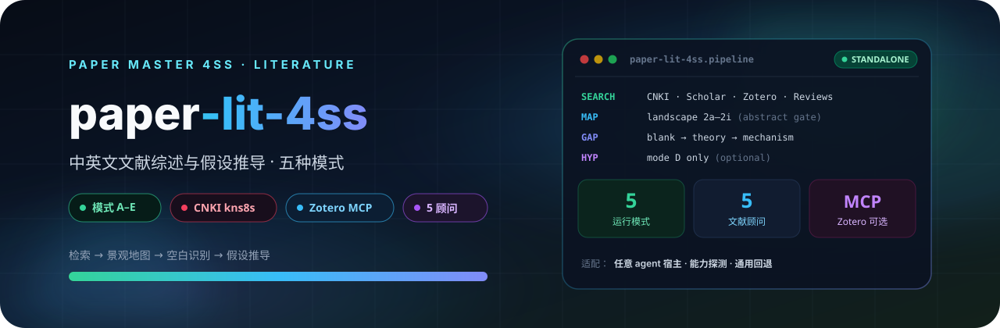

<p align="center">
  
</p>

# Paper 文献综述 4SS

中英文双语文献检索下载、文献综述与假设推导一体化技能。支持五种模式：完整文献地图（A）、定向综述（B）、快速概览（C）、文献综述+假设推导（D）、中文/书目批量落地（E）。集成 lit-down 检索下载管线：英文走 Crossref 定位 DOI、按年份分流 Sci-Hub 镜像与 OA 链（Unpaywall/OpenAlex/Europe PMC/arXiv/NBER）、web_search 机构库补位与 LibGen 专著书轮；中文走 NCPSSD 免登录定位（64 种 CSSCI 顶刊分级）与知网机构出口（专业检索+下载单+Referer 直取），配备四件套内容校验、断点续跑与 MinerU/Zotero/文献地图交接。

## 4SS 家族

| 包 | 职责 |
|---|---|
| [paper-master-4ss](https://github.com/JingYangYuan/paper-master-4ss) | 总控：登记输入、选择模块、维护工作区 |
| [paper-design-4ss](https://github.com/JingYangYuan/paper-design-4ss) | 选题、框架路由、研究设计蓝图 |
| **[paper-lit-4ss](https://github.com/JingYangYuan/paper-lit-4ss)**（本仓库） | 中英文检索、文献地图、空白与假设 |
| [paper-outline-4ss](https://github.com/JingYangYuan/paper-outline-4ss) | 素材转大纲、证据映射、缺口报告 |
| [paper-analysis-4ss](https://github.com/JingYangYuan/paper-analysis-4ss) | 定量 / 质性 / 混合，Stata · R · Python |
| [paper-write-4ss](https://github.com/JingYangYuan/paper-write-4ss) | 章节写作、润色、语言扫描、正文净稿 |
| [paper-check-4ss](https://github.com/JingYangYuan/paper-check-4ss) | 全文审稿、质量门控与精确回流 |
| [paper-submission-4ss](https://github.com/JingYangYuan/paper-submission-4ss) | Word 导出、体例、投稿清单与信函 |
| [paper-update-4ss](https://github.com/JingYangYuan/paper-update-4ss) | 待审核更新包，不直接改核心文件 |
| [paper-mechanigraph-4ss](https://github.com/JingYangYuan/paper-mechanigraph-4ss) | 纯矢量学术机制图生成、拓扑匹配与视觉自检 |

## 它做什么

集成 `lit-down` 文献检索下载管线与文献综述流程：方向确认 → 探活与出口 IP 检查 → 定位分流（中文走 NCPSSD 免登录定位与 64 种 CSSCI 顶刊分级；英文走 Crossref + audit）→ 下载落地（英文按年份分流 `mirror-first` / `oa-first` + `web_search` 补位 + LibGen 专著书轮；中文走知网专业检索 + 下载单直取）→ 四件套内容校验 → 注册表归档与 MinerU 全文化 → 文献地图与假设推导（模式 D）。

Zotero 是可选增强。启用后按 `references/zotero-local-mcp.md` 做能力检查、本地库检索、摘要即时入库和全文深读；未启用不得强制安装。

## 五种模式

| 模式 | 用途 |
|---|---|
| A 完整地图 | 6 轮以上双语检索落地，40–80 篇 |
| B 定向综述 | 4 轮核心检索落地，15–30 篇 |
| C 快速概览 | 2 轮快速检索，10–20 篇 |
| D 综述+假设 | 5 轮以上检索落地，含假设推导 |
| E 检索与下载专项 | 中文 NCPSSD→CNKI / 英文 Crossref→镜像/OA/LibGen 批量落地 |

CNKI 取全文与浏览器 CDP 兜底依赖可见浏览器控制（`browser_control`）：统一走 `ego-browser` 后端（见 `references/browser.md` 与 `references/cnki.md`）；纯英文 HTTP 渠道与中文 NCPSSD 定位无需浏览器即可执行。

## 安装

将本目录放到宿主的 skill 目录。入口见 `SKILL.md`。

```bash
git clone https://github.com/JingYangYuan/paper-lit-4ss.git
```

与 [`paper-master-4ss`](https://github.com/JingYangYuan/paper-master-4ss) 同级安装时，跨模块路径才能解析。只做本模块任务也可以单独使用。

## 与总控的关系

本包由总控 [`paper-master-4ss`](https://github.com/JingYangYuan/paper-master-4ss) 导出；对应源目录是总控包内的 `modules/lit/`：

- 包内相对路径相对本包根目录解析
- `master/` 与部分 `references/` 是导出时的协议快照
- 更新方式：修改总控任一模块、家族表、路由或协议后，必须无参数重新导出**全部**独立包并 push 全部 GitHub 仓；不要只改本仓库，也不要只导出改过的那一个。

## License

[MIT](LICENSE)
